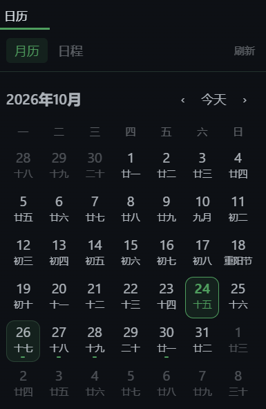

# Hermes Calendar Pane · 日历看板

为 **Hermes Agent 桌面端**制作的 Google Calendar 日历面板，提供中文月历与日程列表。

> **本项目由 GPT 生成。** 代码与初版文档由 GPT 在 Hermes Agent 环境中按用户需求生成并迭代，不是 Hermes 官方插件。当前属于实验性个人项目，安装前请审阅代码并备份原配置。



## 目前实现的主要功能

- **月历 / 日程双视图**，保存上次选择的视图。
- **中文月历**：周一至周日排列、公历和农历日期、部分传统节日。
- **今天高亮**采用主题色的**圆角方形细边框**；选中日期另有背景提示。
- 上个月 / 下个月切换，一键回到今天；点击日期显示当天日程。
- 有日程的日期下方显示小标记，悬停可查看摘要和时间。
- **未来 14 天日程列表**，显示全天事件和具体起止时间。
- 读取 Google Calendar 的 `primary` 日历；默认获取今天附近至未来约 **120 天**的数据。
- 手动刷新、每 5 分钟自动刷新；后端缓存 120 秒。
- 通过 **Hermes 原生标签页拖放**调整位置、分屏或合并标签组；不强制在每次启动时回到右侧。
- 配色跟随 Hermes 主题；无需前端打包，直接加载普通 JavaScript ESM。

## 当前边界与已知限制

- **只读展示**：没有在面板中创建、编辑、删除事件的功能。
- 可翻阅任意月份，但**不会随翻月请求历史数据**；同步窗口外会提示未完整同步，不能据此判断当天没有安排。
- 农历使用浏览器 `Intl` 的中国历支持，节日只覆盖代码中列出的部分传统节日；**没有完整节气、法定节假日或调休算法**。
- 今天/月份网格依据运行设备的本地日期；日程日期和时间沿用后端返回的 ISO 字符串，**尚未做跨时区统一换算**。
- 刷新按钮可能命中后端的两分钟缓存；不是每次点击都绕过缓存。
- 长时间跨午夜运行时，日期刷新可能要等下一次渲染/刷新。
- 依赖 Hermes 桌面插件 SDK 及 dashboard API，**不是独立网页日历**。最初在 Windows + Hermes 的一个本地构建（Git HEAD `bf0203a794a07aac3ff764972ab9087baa4e4f4e`）验证；不承诺所有版本/平台兼容。

## 架构

```text
桌面面板 desktop/plugin.js
  └─ ctx.rest('/agenda?days=120')
      └─ dashboard/plugin_api.py
          └─ 当前 Hermes Python 调用 google-workspace/scripts/google_api.py
              └─ Google Calendar API
```

本项目**不附带 Google OAuth token、客户端密钥、用户日程、个人配置或 google-workspace 技能代码**。后端复用用户本机已有的 google-workspace 技能。

```text
calendar-pane/
├── __init__.py                 # 原生插件入口（不注册 Agent 工具）
├── plugin.yaml
├── dashboard/
│   ├── manifest.json
│   └── plugin_api.py           # 只读 agenda / health 路由
└── desktop/
    └── plugin.js              # 月历、日程与原生 pane 注册
```

## 安装前置条件

1. 安装支持桌面插件的 [Hermes Agent](https://hermes-agent.nousresearch.com/docs/)。
2. 本机已安装 `google-workspace` 技能，文件位于：
   `<HERMES_HOME>/skills/productivity/google-workspace/scripts/google_api.py`。
3. 按该技能说明完成自己的 Google OAuth 授权，并启用 Google Calendar API。授权文件保存在自己的 Hermes 数据目录，**不要提交到 GitHub**。
4. Hermes 当前 Python 环境具有 `fastapi` 及 google-workspace 所需的 Google API 客户端依赖。
5. 若需代理访问 Google：必须按自己的环境配置 google-workspace 的网络链路。原作者本地曾给该技能增加 Windows 系统代理读取与 httplib2 代理适配，**该修改不包含在本仓库，不能假设原版技能自动支持**。使用 httplib2 代理时需在实际执行脚本的 Python 环境安装 PySocks；只设置 `HTTPS_PROXY` 不保证 httplib2 自动使用它。

用实际 Hermes Python 检查，而不是随便使用 PATH 里的 `python`：

```powershell
& '<Hermes Python 的完整路径>' '<HERMES_HOME>\skills\productivity\google-workspace\scripts\setup.py' --check
```

`--check` 主要核对本地授权，不证明网络可达。还应按技能说明实跑只读 `calendar list`。若需要 PySocks：

```powershell
uv pip install --python '<Hermes Python 的完整路径>' pysocks==1.7.1
```

Hermes 升级更换 Python 环境后需要重新检查依赖。安装前可先看 `hermes plugins --help`，以当前版本官方说明为准。

## 手动安装（PowerShell）

先克隆本仓库。以下命令在仓库根目录执行，**目标已存在时必须先自行备份，不能直接覆盖**。

```powershell
$HermesHome = if ($env:HERMES_HOME) { $env:HERMES_HOME } else { Join-Path $env:LOCALAPPDATA 'hermes' }
$Target = Join-Path $HermesHome 'plugins\calendar-pane'
if (Test-Path $Target) { throw 'calendar-pane 已存在，请先备份并人工确认更新范围。' }
New-Item -ItemType Directory -Path $Target | Out-Null
Copy-Item '__init__.py','plugin.yaml','dashboard','desktop' -Destination $Target -Recurse
hermes plugins enable calendar-pane
```

然后：

1. **在不影响正在执行的任务时重新启动承载 dashboard 的 Hermes 后端**，使新增 API 路由挂载；不要在进行中的 gateway 对话里直接杀掉自己。
2. 在桌面 **设置 → 能力 / 插件** 中扫描插件，启用 `calendar-pane` 的桌面部分。
3. 若需要，在命令面板执行 **Reload desktop plugins**。
4. 桌面宿主通常会把 `desktop/plugin.js` 复制到 `<HERMES_HOME>/desktop-plugins/calendar-pane/plugin.js`；实际加载的是这个副本。UI 开关与 Python 插件启用是两道独立开关。

拖动顶部**原生「日历」标签页**调整布局，不是拖面板内部的视图按钮。

## 排障

| 现象 | 检查 |
|---|---|
| 插件不加载 | 包根是否有 `__init__.py`，插件是否启用 |
| 面板有了但 API 404 | 承载 dashboard 的后端是否在安装后重启；不要把其他 API 端口当 dashboard |
| `WinError 10060` / 读取超时 | Google 访问链路、实际 Python 环境的 PySocks、google-workspace 的代理实现 |
| `health` 通过但读取失败 | health 只检查技能脚本和 token 是否存在，不测试授权或网络 |
| 事件未立即更新 | 后端缓存 120 秒，前端自动刷新 5 分钟 |
| 历史日期无事件 | 目前只获取今天附近和未来约 120 天，不同步历史月份 |

后端使用 `HERMES_HOME`（优先通过 Hermes 的路径解析）定位技能和 token。若技能路径不同，需要明确调整后端，不能把密钥放进前端。

## 测试

本仓库使用**合成测试数据**，不读取发布者私人日历或运行中的 Hermes 实例。

```bash
node --test tests/calendar.test.cjs
python -m unittest discover -s tests -p "test_*.py" -v
node --check desktop/plugin.js
```

JavaScript 测试用轻量 JSX 对象执行纯日期逻辑和 DayCell 结构，不替代真实 Electron 中的视觉/拖放端到端测试。Python 测试验证事件规范化与缓存，网络调用被替换，不访问 Google。

## 安全与卸载

- `.env`、OAuth 文件、密钥、数据库、真实事件响应和日志不得入库。
- 插件后端依赖宿主鉴权；不要把 dashboard 直接裸露到公网。
- 前端只向宿主后端读数据，没有主动上报地址；后端仅调用本机技能读取 Google 日历。
- 卸载优先先关闭桌面插件，再运行 `hermes plugins --help` 查看当前版本移除命令；可能残留的 `desktop-plugins/calendar-pane` 副本只在确认归属并备份后删除。
- 不要为卸载插件删除自己的 Google token、整个技能目录或日历事件。
- 若独立补装过 PySocks，可在确认其他功能不再需要时用 `uv pip uninstall --python '<Hermes Python 的完整路径>' pysocks` 撤销。

## 生成说明

**本插件由 GPT 生成并按用户反馈迭代。** 用户提供需求、布局参考与实际使用反馈。项目不声称由 OpenAI 或 Hermes 官方维护，不代表相关公司的产品承诺。AI 生成代码仍可能存在缺陷，欢迎提交问题和修复。
